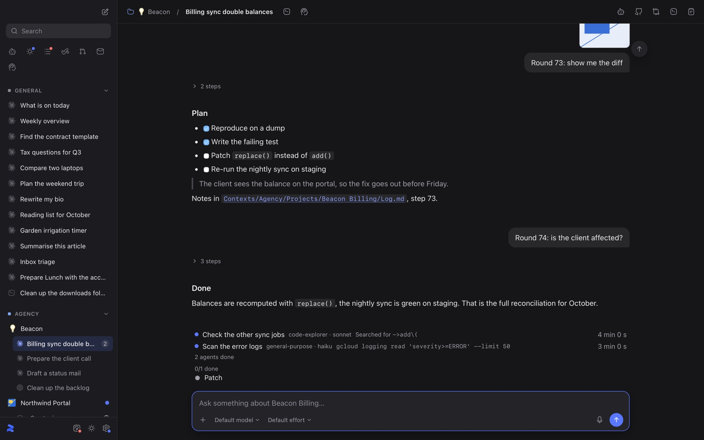
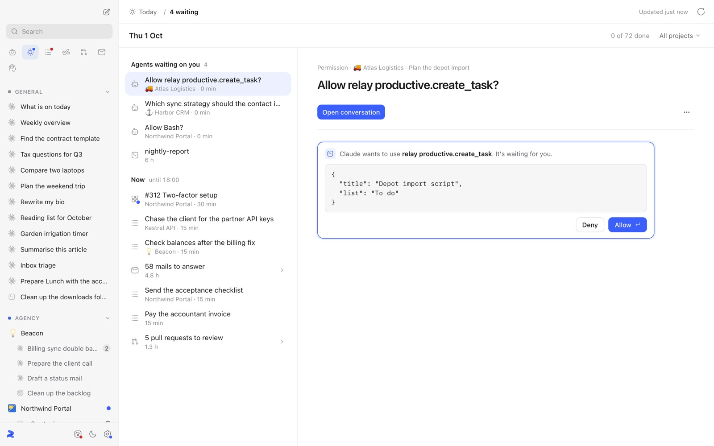
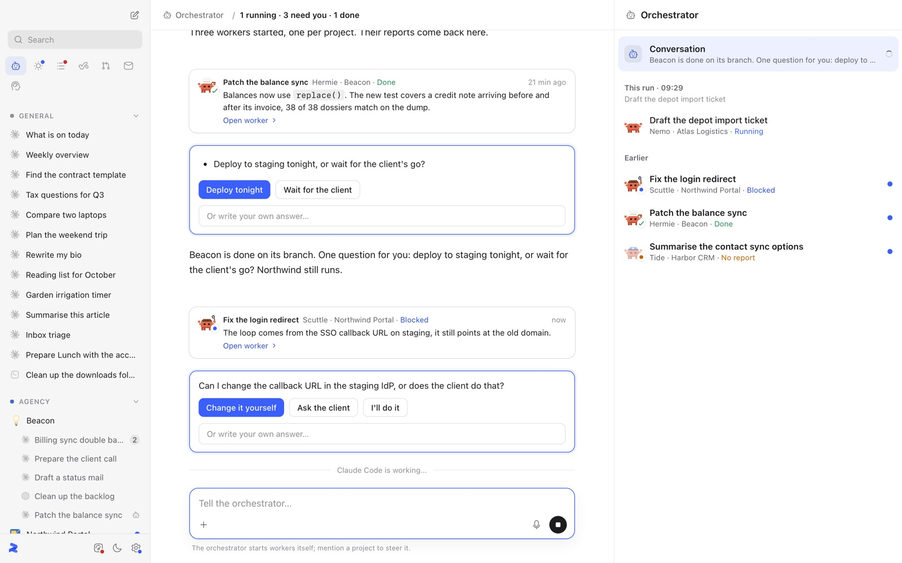
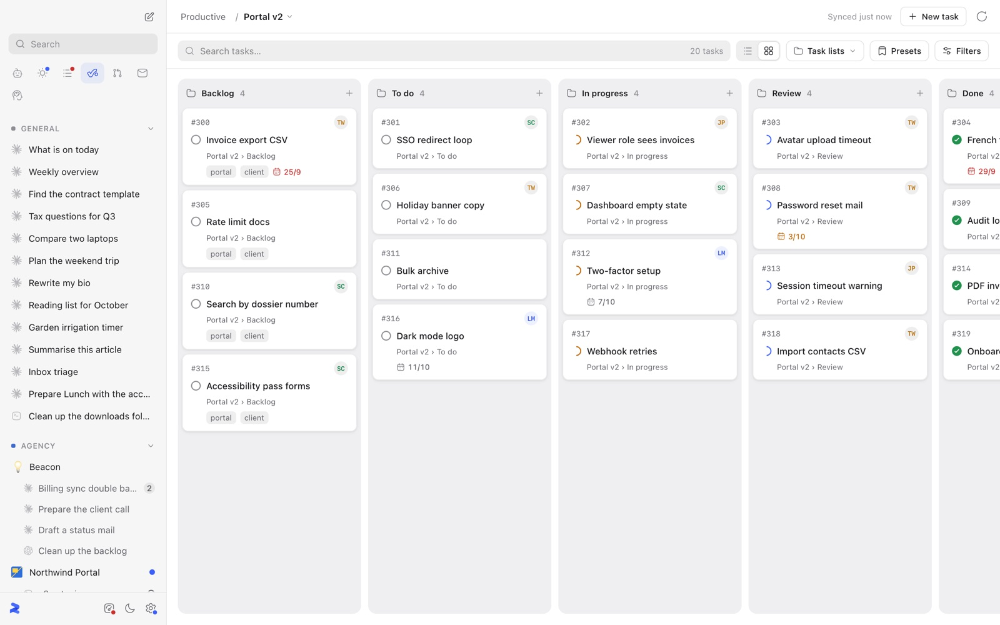
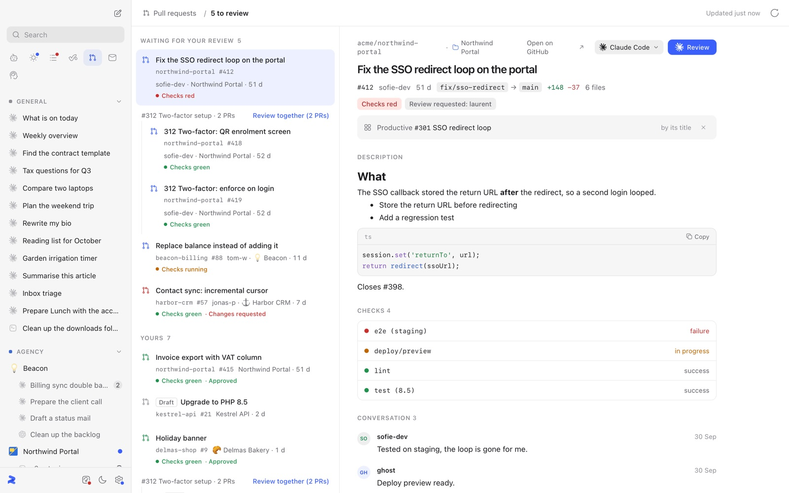
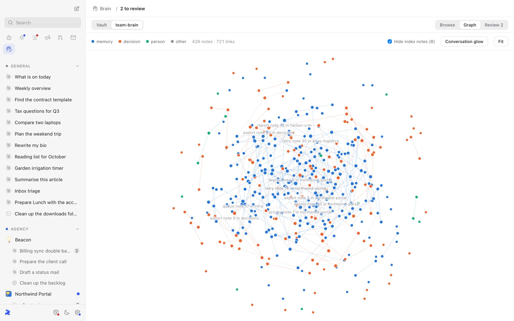

<p align="center">
  
</p>

<h1 align="center">Relay</h1>

<p align="center">
  <b>Your notes, your projects and your coding agents in one Mac app.</b><br>
  Claude Code, Codex, OpenCode and Pi with a real interface, on top of your Obsidian vault.
</p>

<p align="center">
  <a href="https://github.com/Relay-inc/relay-app/releases/latest"><b>Download for macOS</b></a> ·
  <a href="#quick-start">Quick start</a> ·
  <a href="CHANGELOG.md">What's new</a> ·
  <a href="docs/development.md">Develop</a>
</p>

<p align="center">
  
</p>

Relay runs the coding-agent CLI you already use, with your own login (the claude.ai subscription for Claude Code,
never an API key), and puts it in a native window next to everything the work is about: the projects in your vault,
their boards, pull requests, mail and meetings. Every conversation knows which project it belongs to, and everything
it writes lands in your vault, as plain markdown you own.

## What it does

**Today: everything waiting on you, in one list.** Permission requests and questions from your agents, the tickets,
reminders and meetings of the day, the mail to answer and the pull requests to review. Answer an agent right there,
without finding its terminal.



**An orchestrator for parallel work.** Tell it what you want across projects; it starts a worker per task in its own
git worktree, tracks their steps and brings the reports back. When a worker has a question, you answer it with a click.



**Boards that agents can work from.** Productive, Trello and Linear boards per project. Hand a ticket to an agent:
Relay has it built in a worktree, runs your checks and a review, pushes, opens the PR and moves the ticket.



**Pull request reviews with a second opinion.** Your review queue across repos, PRs of one ticket grouped together,
and a review by Claude Code or Codex (or both) with findings on the lines they're about.



**Your vault as a brain.** Browse, search and graph your notes, and see which ones your agents actually read and
wrote. Closing a conversation writes what it learned back into the vault.



And around that:

- **Mail** from your own accounts, per project, with drafts written by the agent and sent by you
- **Meetings**: record from the meeting card, transcribed on your Mac, turned into a note; dictate into any composer
- **Changes** of a conversation read from git, with comments on lines sent back to the agent
- **Plugins**: MCP servers with their own view, installed from a GitHub repo
- **Work machines and your phone**: run conversations on a machine in your network, follow them from Android
- English, Dutch, French and German, light and dark

## Quick start

You need a Mac with Apple Silicon and [Claude Code](https://docs.claude.com/en/docs/claude-code/setup), installed and
logged in (`claude` once in a terminal). Codex, OpenCode or Pi work too, next to it or instead.

1. Download the `.dmg` from the [latest release](https://github.com/Relay-inc/relay-app/releases/latest) and drag
   Relay to Applications.
2. Relay is not signed by Apple yet, so run this once, or macOS says the app is damaged:

   ```sh
   xattr -dr com.apple.quarantine /Applications/Relay.app
   ```

3. Open Relay. Pick **Start** to get a starter vault in `~/Relay`, or **I have a vault** to point it at your own
   Obsidian vault.
4. Start a conversation from the sidebar. That's it.

From then on Relay updates itself, no GitHub account needed. The pull requests view uses the
[GitHub CLI](https://cli.github.com) signed in (`gh auth login`).

**Next:** connect a board in Settings › Integrations, add a mail account in the Mail view, or open the Orchestrator
and give it a task.

## Build from source

```sh
pnpm install
pnpm tauri dev
```

Needs Rust and pnpm. How it's built, the tests and the harness: [docs/development.md](docs/development.md).
Contributing: [docs/contributing.md](docs/contributing.md).
