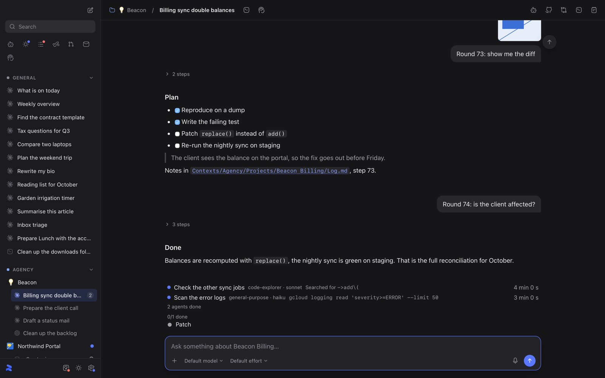
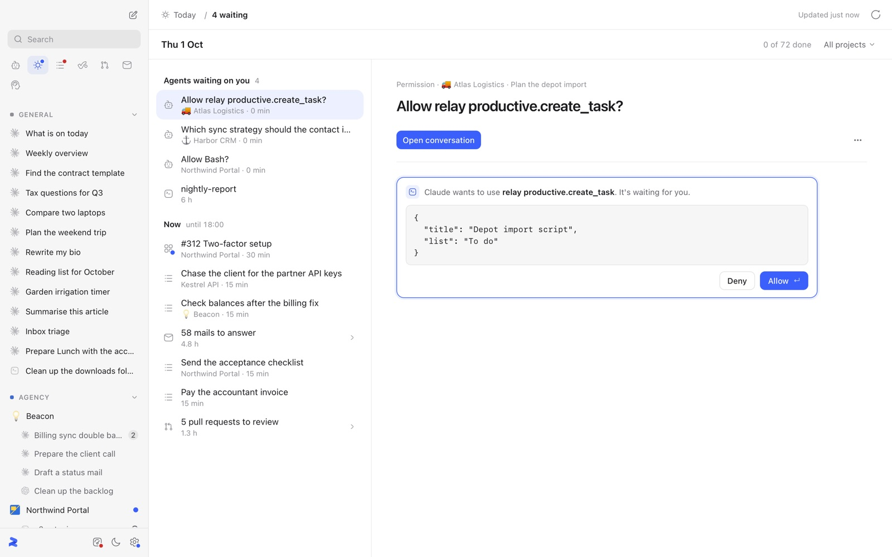
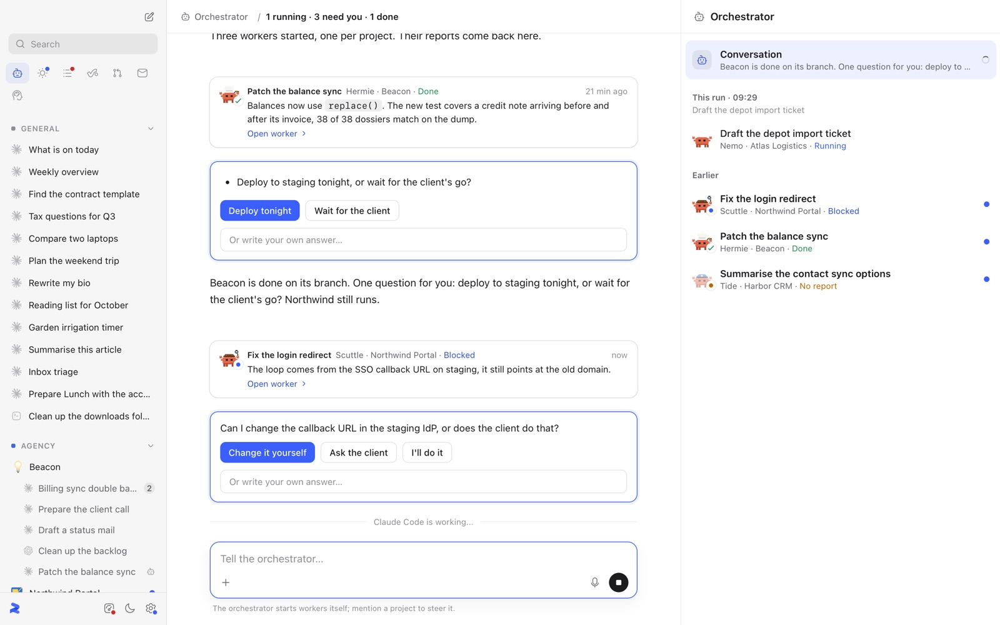
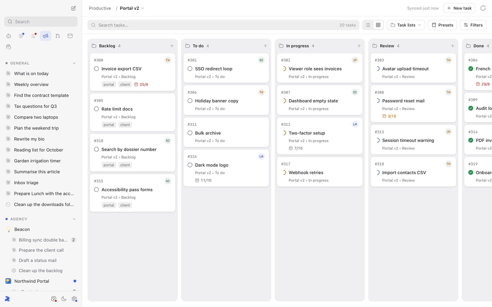
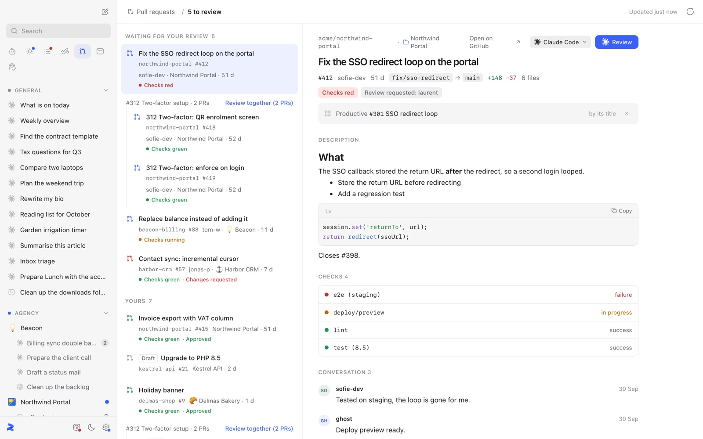
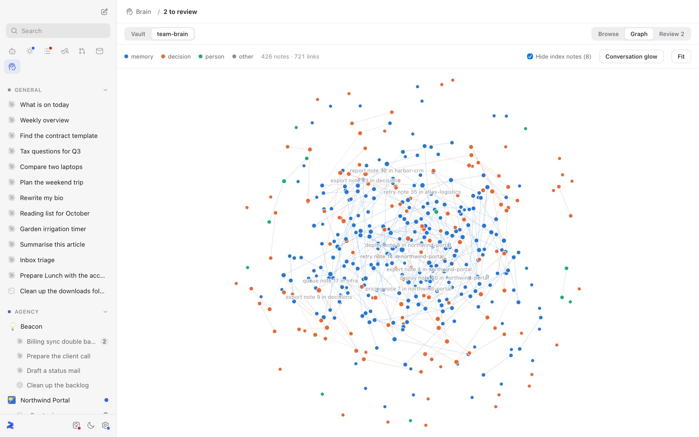

<p align="center">
  
</p>

<h1 align="center">Relay</h1>

<p align="center">
  <b>Your notes, your projects and your coding agents in one Mac app.</b><br>
  Claude Code, Codex, OpenCode and Pi with a real interface, on top of your Obsidian vault.
</p>

<p align="center">
  <a href="https://github.com/Relay-inc/relay-app/releases/latest"><b>Download for macOS</b></a> ·
  <a href="#quick-start">Quick start</a> ·
  <a href="CHANGELOG.md">What's new</a> ·
  <a href="docs/development.md">Develop</a>
</p>

<p align="center">
  
</p>

Relay runs the coding-agent CLI you already use, with your own login (the claude.ai subscription for Claude Code,
never an API key), and puts it in a native window next to everything the work is about: the projects in your vault,
their boards, pull requests, mail and meetings. Every conversation knows which project it belongs to, and everything
it writes lands in your vault, as plain markdown you own. Share a workspace with your team and their conversations
work from the same notes.

## What it does

**Today: everything waiting on you, in one list.** Permission requests and questions from your agents, the tickets,
reminders and meetings of the day, the mail to answer and the pull requests to review. Answer an agent right there,
without finding its terminal. Prepare a meeting and its briefing is written into the meeting's note.



**Conversations with the project next to them.** Follow the agents Claude Code starts in their own column, open the
project's terminal, Git, Files or Claude Design drawer beside the chat, and see per turn what it edited and cost. The
Git drawer stages, commits and pushes across every repo of the project, with side-by-side diffs and a branch graph.

**An orchestrator for parallel work.** Tell it what you want across projects and it starts a worker per task in its own
git worktree, tracks their steps and brings the reports back. When a worker has a question, you answer it with a click.



**Boards that agents can work from.** Productive, Trello and Linear boards per project (Linear cycles too). Hand a
ticket to an agent: Relay has it built in a worktree, runs your checks and a review, pushes, opens the PR and moves
the ticket. Name a Claude Code skill and the agent follows your own flow instead.



**Pull request reviews with a second opinion.** Your review queue across repos, PRs of one ticket grouped together,
and a review by Claude Code or Codex (or both) with findings on the lines they're about.



**Your vault as pages.** Browse, search and edit your notes, draw them as a graph, and see which ones your agents read and wrote. The
vault keeps up by itself: a conversation that settles down is read for decisions, where a project stands and dated
follow-ups, and those go into the vault.



**Workspaces for a team.** Your own vault is your Personal workspace. Next to it you add other vault folders and team
workspaces that a relay-server syncs to every member's Mac, end-to-end encrypted: the server only stores what each Mac
sealed. Pick the workspace in the sidebar's footer (⌃1 to ⌃9), move or copy a project to another one, and invite
members with a link. Your mail, reminders and calendar never go into a team workspace. How it works and what the
server can and cannot see: [docs/workspaces.md](docs/workspaces.md).

And around that:

- **Mail** from your own accounts, per project, with drafts written by the agent and sent by you
- **Meetings**: record from the meeting card, transcribed on your Mac, turned into a note. Dictate into any composer
- **Plugins**: MCP servers with their own view, installed from a GitHub repo
- **Work machines and your phone**: run conversations on a machine in your network, follow them from Android, or
  continue a Mac conversation on your phone with `/share-phone`
- **Git backup** of the vault to a remote of your own, every 5 to 60 minutes
- **Usage**: plan limits per agent, tokens and cost, and which notes your agents read most
- More than one window (⌘N), find in a conversation (⌘F), every shortcut changeable in Settings › Shortcuts
- English, Dutch, French and German, light and dark

**Experimental:** Settings › General › Experimental › Files adds a Pages tab next to Chats: notes open as pages you
edit in place (slash menu, properties, history, comments), and in a team workspace members edit the same page live.
Off by default, and it may still change.

## Quick start

You need a Mac with Apple Silicon and [Claude Code](https://docs.claude.com/en/docs/claude-code/setup), installed and
logged in (`claude` once in a terminal). Codex, OpenCode or Pi work too, next to it or instead.

1. Download the `.dmg` from the [latest release](https://github.com/Relay-inc/relay-app/releases/latest) and drag
   Relay to Applications.
2. Open Relay. Apple has not notarized it yet, so macOS refuses the first time: open System Settings › Privacy &
   Security and click **Open Anyway**. (Or run `xattr -dr com.apple.quarantine /Applications/Relay.app` once.)
3. Pick **Start** for a fresh workspace in `~/Relay`, or **I have a vault** to point it at your own Obsidian vault.
   **Set up with Claude** then asks a few questions about you, your work and your projects (about ten minutes,
   every part can be skipped).
4. Start a conversation from the sidebar. That's it.

From then on Relay updates itself, no GitHub account needed. The pull requests view uses the
[GitHub CLI](https://cli.github.com) signed in (`gh auth login`).

**Next:** connect a board in Settings › Integrations, add a mail account in the Mail view, open the Orchestrator and
give it a task, or invite your team to a workspace in Settings › Workspaces.

## Build from source

```sh
pnpm install
pnpm tauri dev
```

Needs Rust and pnpm. How it's built, the tests and the harness: [docs/development.md](docs/development.md).
Contributing: [docs/contributing.md](docs/contributing.md).

## License

Source-available under the [Functional Source License](LICENSE.md) (FSL-1.1-ALv2): use, change and share it for
anything but a competing commercial product. Every release becomes Apache-2.0 two years after it ships.
