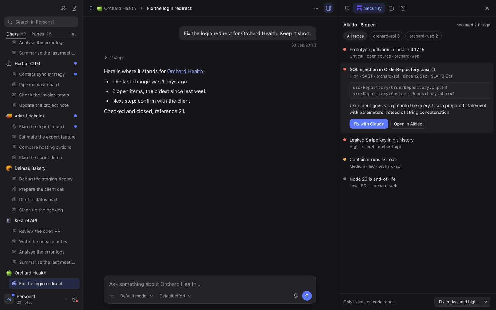
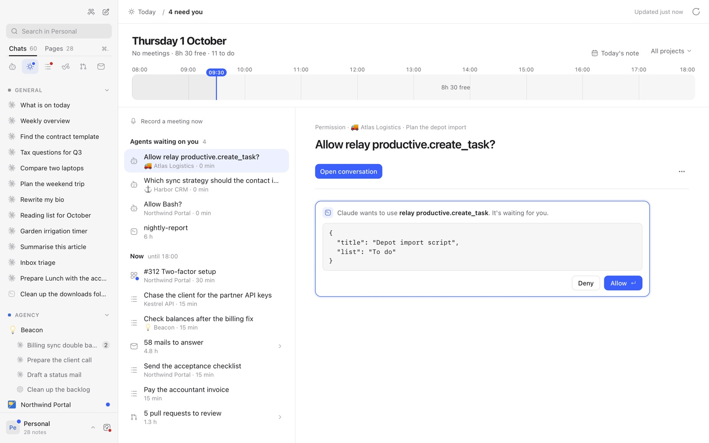
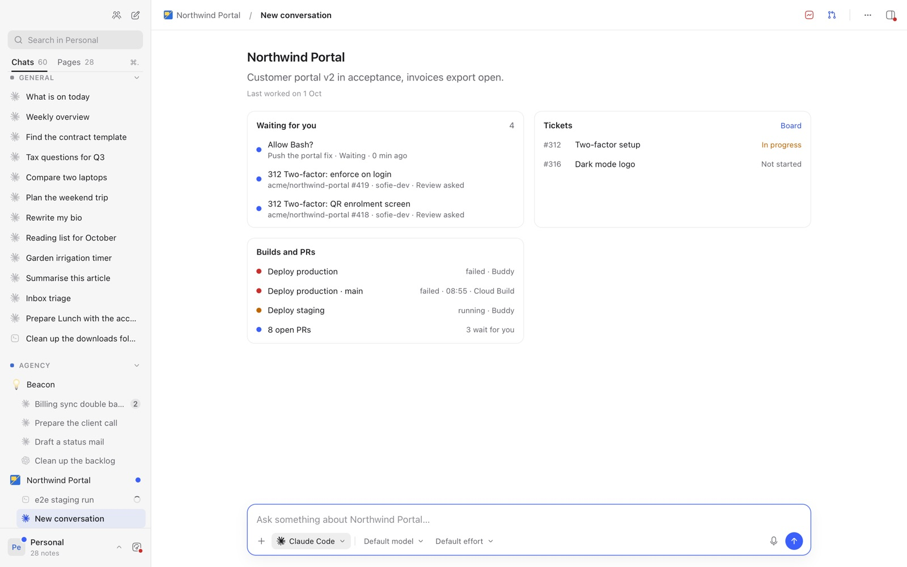
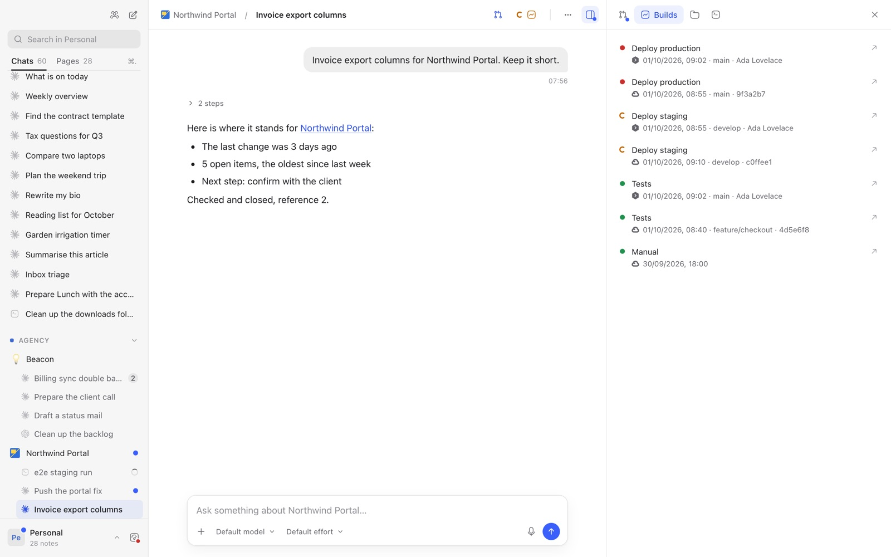
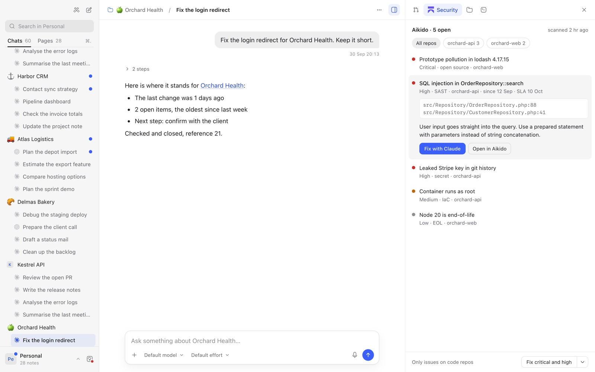
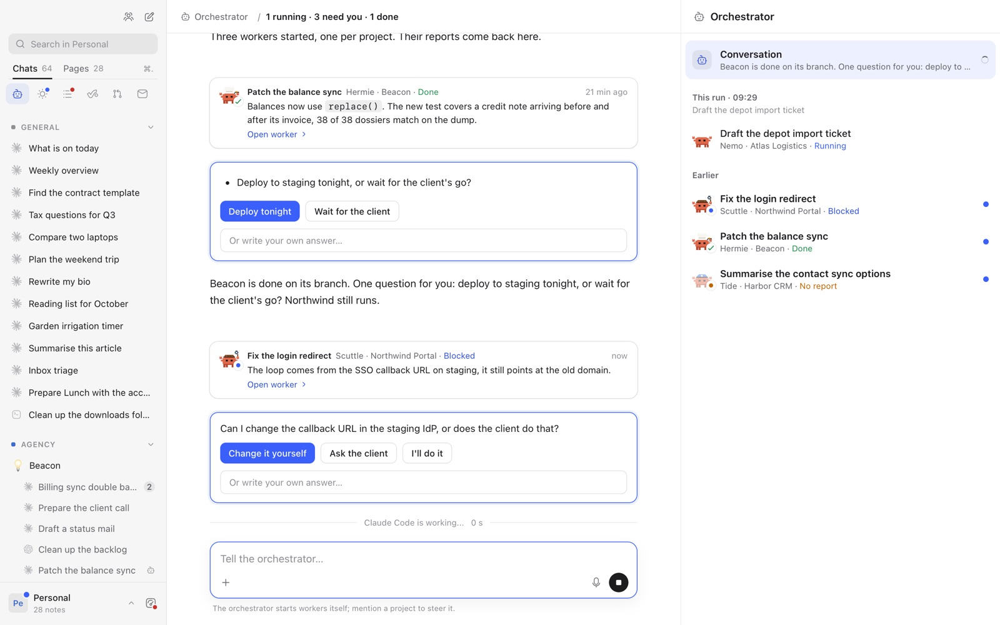
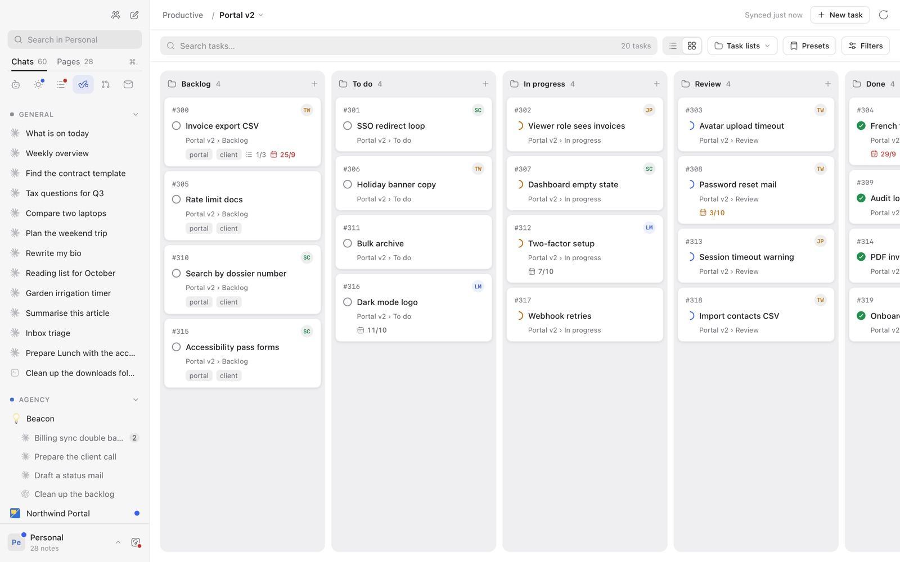
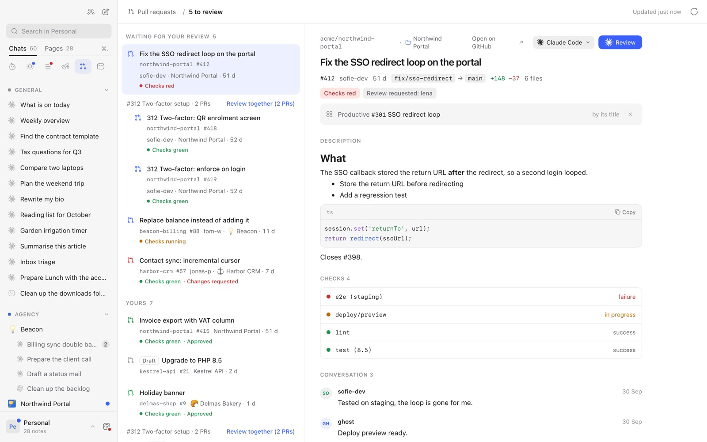
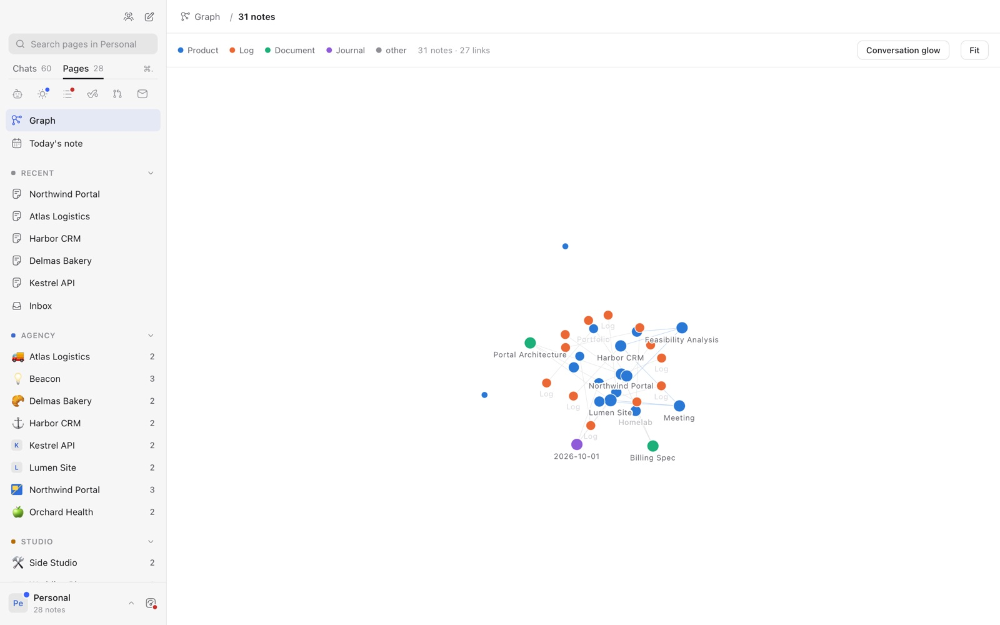

<p align="center">
  
</p>

<h1 align="center">Relay</h1>

<p align="center">
  <b>Your notes, your projects and your coding agents in one Mac app.</b><br>
  Claude Code, Codex, OpenCode, Pi and Antigravity with a real interface, on top of your Obsidian vault.
</p>

<p align="center">
  <a href="https://github.com/Relay-inc/relay-app/releases/latest"><b>Download for macOS</b></a> ·
  <a href="#quick-start">Quick start</a> ·
  <a href="CHANGELOG.md">What's new</a> ·
  <a href="docs/development.md">Develop</a>
</p>

<p align="center">
  
</p>

Relay runs the coding-agent CLI you already use, with your own login (the claude.ai subscription for Claude Code,
never an API key), and puts it in a native window next to everything the work is about: the projects in your vault,
their boards, pull requests, builds, security findings, mail and meetings. Every conversation knows which project it belongs to, and everything
it writes lands in your vault, as plain markdown you own. Share a workspace with your team and their conversations
work from the same notes.

## What it does

**Today: everything waiting on you, in one list.** Permission requests and questions from your agents, the tickets,
reminders and meetings of the day, the mail to answer and the pull requests to review. Answer an agent right there,
without finding its terminal. Prepare a meeting and its briefing is written into the meeting's note.



**Conversations with the project next to them.** Follow the agents Claude Code starts in their own column and see per
turn what it edited and cost. A new conversation in a project opens on its home: where you left off, what waits on you,
your tickets, and the failed or running builds and open PRs, one click each.



**Everything about a project, one click away.** The project panel beside the chat has a tab each for pull requests,
builds, security, Git, Files and a Terminal; a dot on a tab or in the title bar says which one needs you (a failed
build, a review that waits, a critical finding). Git stages, commits and pushes across every repo of the project, with
side-by-side diffs and a branch graph.

- **Builds** lists the project's Buddy pipelines and Google Cloud Build triggers with their state.
- **Security** shows the open Aikido findings of the project's GitHub repos, worst first, with where they are and how
  to fix them. **Fix with Claude** starts a conversation on one finding, and the Fix button on all critical and high
  ones, only the critical, quick wins, dependency updates or everything. Both integrations are read-only: set them up
  under Settings › Integrations.





**An orchestrator for parallel work.** Tell it what you want across projects and it starts a worker per task in its own
git worktree, tracks their steps and brings the reports back. When a worker has a question, you answer it with a click.



**Boards that agents can work from.** Productive, Trello, Linear, Jira and GitHub Projects boards per project. Hand a
ticket to an agent: Relay has it built in a worktree, runs your checks and a review, pushes, opens the PR and moves
the ticket. Name a Claude Code skill and the agent follows your own flow instead. A board pipeline can work a whole board this
way, with its own conversation that brings you the questions, plans and failed runs.



**Pull request reviews with a second opinion.** Your review queue across repos, PRs of one ticket grouped together,
and a review by Claude Code or Codex (or both) with findings on the lines they're about.



**Your vault as pages.** Search your notes with ⌘K, open them next to a conversation, and see which ones your agents
read and wrote. The Pages tab (experimental, below) adds editing in place and a graph of the notes. The vault keeps up by itself: a conversation that settles down is read for decisions, where a project stands and dated
follow-ups, and those go into the vault.



## Quick start

You need a Mac (Apple silicon or Intel) and [Claude Code](https://docs.claude.com/en/docs/claude-code/setup), installed and
logged in (`claude` once in a terminal). Codex, OpenCode, Pi or Antigravity work too, next to it or instead.

1. Download the `.dmg` from the [latest release](https://github.com/Relay-inc/relay-app/releases/latest) and drag
   Relay to Applications.
2. Open Relay. Apple has not notarized it yet, so macOS refuses the first time: open System Settings › Privacy &
   Security and click **Open Anyway**. (Or run `xattr -dr com.apple.quarantine /Applications/Relay.app` once.)
3. Pick **Start** for a fresh workspace in `~/Relay`, or **I have a vault** to point it at your own Obsidian vault.
   **Set up with Claude** then asks a few questions about you, your work and your projects (about ten minutes,
   every part can be skipped).
4. Start a conversation from the sidebar. That's it.

From then on Relay updates itself, no GitHub account needed. The pull requests view uses the
[GitHub CLI](https://cli.github.com) signed in (`gh auth login`).

**Next:** connect a board in Settings › Integrations, add a mail account in the Mail view, open the Orchestrator and
give it a task, or invite your team to a workspace on Servers and organisations (the workspace menu).

## Build from source

```sh
pnpm install
pnpm tauri dev
```

Needs Rust and pnpm. How it's built, the tests and the harness: [docs/development.md](docs/development.md).
Contributing: [docs/contributing.md](docs/contributing.md).

## License

Source-available under the [Functional Source License](LICENSE.md) (FSL-1.1-ALv2): use, change and share it for
anything but a competing commercial product. Every release becomes Apache-2.0 two years after it ships.
